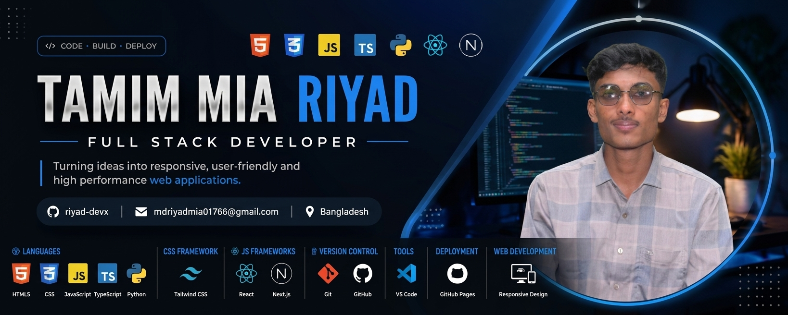

<!-- ======================= BANNER ======================= -->

  

<!-- ======================= INTRO ======================= -->

<h1 align="center">Hi 👋, I'm Tamim Mia Riyad</h1>

<h3 align="center">
  Future Full Stack Developer | Learning, Building & Growing 🚀
</h3>

  

---

<!-- ======================= ABOUT ME ======================= -->

## 👨‍💻 About Me

- 🌱 I’m currently learning **HTML, CSS, JavaScript & TypeScript**
- ⚛️ Exploring **React & Next.js**
- 🐍 Learning **Python**
- 🎨 Interested in **Figma, Photoshop & Illustrator**
- 📱 Interested in **Responsive Web Design**
- 🚀 My goal is to become a **Full Stack Developer**
- 🇧🇩 From **Bangladesh**

---

<!-- ======================= CONNECT ======================= -->

## 🤝 Connect With Me

📫 **Email:** mdriyadmia01766@gmail.com

---

<!-- ======================= TOOLS ======================= -->

# 🛠️ Tools & Technologies

## 💻 Languages

  

---

## 🎨 CSS Frameworks & Libraries

  

---

## ⚛️ JavaScript Frameworks & Libraries

  

---

## 🔧 Version Control

  

---

## 💻 Development Tools

  

---

## 🚀 Deployment Platform

  

---

## 🎨 Design & Graphics

  

---

## 📱 Web Development

---

<!-- ======================= PROFILE TROPHY ======================= -->

## 🏆 GitHub Profile Trophy

  

---

<!-- ======================= FOOTER ======================= -->

<h3 align="center">
  🚀 Keep Learning • Keep Building • Keep Growing
</h3>

<h3 align="center">
  ⭐ Thanks for visiting my profile! ⭐
</h3>
